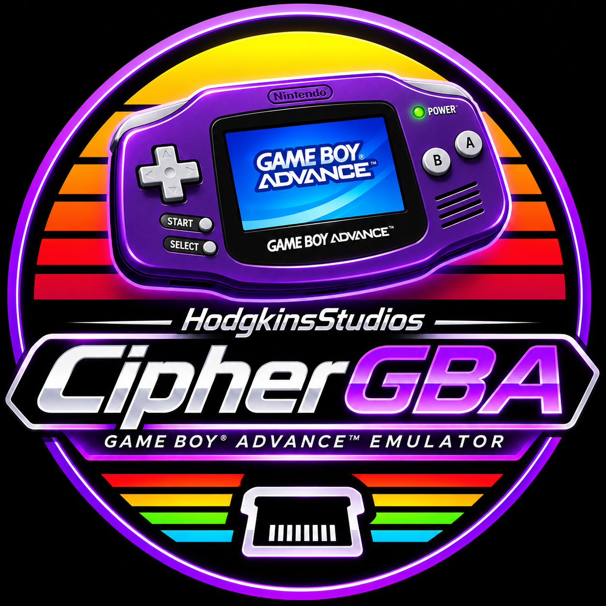

<p align="center"></p>
<h1 align="center">CipherGBA</h1>
<p align="center">A portable C++17 Game Boy Advance emulator by <strong>HodgkinsStudios</strong></p>

<p align="center"><a href="https://github.com/HodgkinsStudios/CipherGBA/releases/tag/v0.1.0">Latest published release (v0.1.0)</a> · <a href="RELEASE_NOTES.md">Release notes</a> · <a href="docs/ACCURACY.md">Accuracy report</a> · <a href="https://github.com/HodgkinsStudios/CipherGBA/actions/workflows/portability.yml">Build checks</a></p>

CipherGBA emulates the Game Boy Advance using an independently maintained GBA core, integrated BIOS high-level emulation (HLE), and optional user-supplied original 16 KiB BIOS firmware. It provides a native Linux X11 frontend and a portable SDL2 frontend for Windows, macOS and Linux.

## Features

- `.gba` game cartridges and supported `.zip` archives.
- Windowed/fullscreen display, aspect-preserving and stretched scaling, pause, reset and speed controls.
- Keyboard and gamepad controls, configurable input mapping, GBA audio and video.
- SRAM, Flash and EEPROM battery saves; save-state slots, PNG screenshots, TAS movies and AVI capture.
- RAW, CodeBreaker, GameShark and Action Replay cheat codes. See [cheat documentation](docs/CHEATS.md).
- A standalone C++17 core available as shared and optionally static libraries.
- One consistent application icon throughout the README, Linux windows, Windows executable, macOS bundle and About dialogs.

### Desktop interface — CP93 design restored for v0.2

Both frontend implementations follow the six-tab **Library / Settings / System / TAS / Cheats / Info** layout from the CP93 full source. Starting without a ROM shows the two-column library/dashboard with clickable **Open ROM**, **Import BIOS**, and **Configure Input** controls rather than displaying a giant logo. Input mapping has a dedicated in-window keyboard/gamepad table for the ten original GBA controls, and cheats have a dedicated management view. F1 opens the Library dropdown. Menu groups expose display, audio, state, capture and input-movie features.

The native Linux X11 frontend uses Xlib; Windows, macOS and portable Linux builds render the corresponding interface using SDL2. Their dialog implementations, menus and feature depth are not yet visually or functionally identical in every detail. The original CP93 C++ core is **not** included: the current GBA core remains unchanged. See [the frontend migration notes](docs/FRONTEND_CP93.md) and [platform differences](docs/PLATFORMS.md).

The project artwork is used in this README, for the **application icon**, and in the **About** view only—not as the emulator's main window. The earlier screenshot has been removed from this README because it does not represent the restored CP93 layout. A verified new screenshot should be captured from an actual v0.2 desktop build before release.

## Supported release packages

The assets below describe the already-published **v0.1.0** release, which predates the CP93 frontend restoration. The forthcoming **v0.2** release must use newly built, independently validated artifacts. Do not mistake the v0.1.0 downloads for updated frontend builds.

| Platform | Release asset |
| --- | --- |
| Windows x64 | `CipherGBA-v0.1-Windows-x64.zip` |
| macOS Apple Silicon | `CipherGBA-v0.1-macOS-arm64.zip` |
| macOS Intel | `CipherGBA-v0.1-macOS-x86_64.zip` |
| Linux X11 x86_64 | `CipherGBA-v0.1-Linux-X11-x86_64.zip` |
| Linux AppImage x86_64 | `CipherGBA-v0.1-Linux-x86_64.AppImage` |
| Linux Flatpak x86_64 | `CipherGBA-v0.1-Linux-x86_64.flatpak` |
| Complete bundle | `CipherGBA-v0.1-ALL-PLATFORMS.zip` |
| Source code | `CipherGBA-v0.1-Source.zip` |

**Windows:** unzip fully and run `CipherGBA.exe` with the adjacent DLL dependencies. **macOS:** unzip the package for your processor and launch `CipherGBA.app`; apps are ad-hoc signed, **not notarized**, and macOS may display security warnings. **Linux X11:** keep `CipherGBA` and `libCipherGBA_Core.so.1` together; host X11 and runtime dependencies are needed.

**AppImage:** set executable permission (`chmod +x CipherGBA-v0.1-Linux-x86_64.AppImage`), then launch the file. **Flatpak:** install with `flatpak install --user ./CipherGBA-v0.1-Linux-x86_64.flatpak`, then use `flatpak run io.github.hodgkinsstudios.CipherGBA`. Flatpak requires the freedesktop 25.08 runtime. See the [platform checklist](docs/PLATFORM_ACCEPTANCE.md) for unverified device-specific behavior.

## Build from source

On Ubuntu/Debian for the Linux X11 frontend:

```sh
sudo apt update
sudo apt install -y build-essential cmake libx11-dev zlib1g-dev python3
./build.sh
./run.sh
```

Build the SDL2 frontend instead:

```sh
sudo apt install -y libsdl2-dev libdbus-1-dev
cmake -S . -B build-sdl -DCMAKE_BUILD_TYPE=Release -DCIPHERGBA_FRONTEND=SDL2 \
  -DPIXELGBA_ENABLE_LTO=OFF
cmake --build build-sdl --target CipherGBA -j 2
./bin/CipherGBA
```

To build only the core, use `cmake -S . -B build-core -DPIXELGBA_BUILD_GUI=OFF` and build the `CipherGBA_Core` target. The Ubuntu Code::Blocks project file is included. Platform-specific CI build recipes are in [`.github/workflows/portability.yml`](.github/workflows/portability.yml). The build scripts do not require copyrighted BIOS or game ROMs.

### Portable SDL2 keys

| Action | Shortcut |
| --- | --- |
| Open ROM / import BIOS | Ctrl+O / Ctrl+B |
| Input mapping / menu | Ctrl+I / F1 |
| Reset / mute | F2 / F4 |
| Save / load state | F5 / F8 |
| Change slot / pause | F6 / F7 |
| Screenshot / stretch | F9 / F10 |
| Fullscreen | Escape or F11 |

Default keyboard: Z=A, X=B, Backspace=Select, Return=Start, arrow keys=D-pad, A=L, S=R. The SDL2 frontend stores persistent user files in OS-specific application-data directories. To **copy** existing saves, states, BIOS, TAS and cheats from a Linux X11 `CipherGBA_Data` directory, run `CipherGBA --import-data /path/to/CipherGBA_Data`. The importer does not overwrite existing destination files; back up important saves before changing installations. X11 keyboard mapping files are not imported.

## Accuracy and status

The recorded numerical test-suite result is **6,994/6,998 (99.9428%) in both HLE and original-BIOS modes**. The four outstanding HBlank-related checks (`Hblank`, `Flip 1`, `Flip 2`, `Flip 3`) are unresolved. Upstream reports question the reliability of some suite expectations, but that does **not** prove these disagreements are test errors or establish 100% hardware accuracy. See the [results and reproduction procedure](docs/ACCURACY.md).

Cross-platform build automation provides compile, packaging, and headless smoke checks. Clean-device GUI/audio/controller verification, universal game compatibility and sustained real-world 59.73 FPS are **not guaranteed**. [Platform validation status](docs/PLATFORM_ACCEPTANCE.md), [local verification](docs/VALIDATION.md) and [performance notes](docs/PERFORMANCE.md) distinguish measured results from pending work.

## Legal information

No Nintendo games or BIOS images are included. Use your own lawfully obtained files. CipherGBA is independent of Nintendo and is not endorsed by Nintendo. No project-wide reuse license has been selected; see [Third-party notices](THIRD_PARTY_NOTICES.md) for specific MPL-2.0-covered cheat lookup data.

For a brand-new GitHub repository, follow [publishing instructions](PUBLISHING.md).
