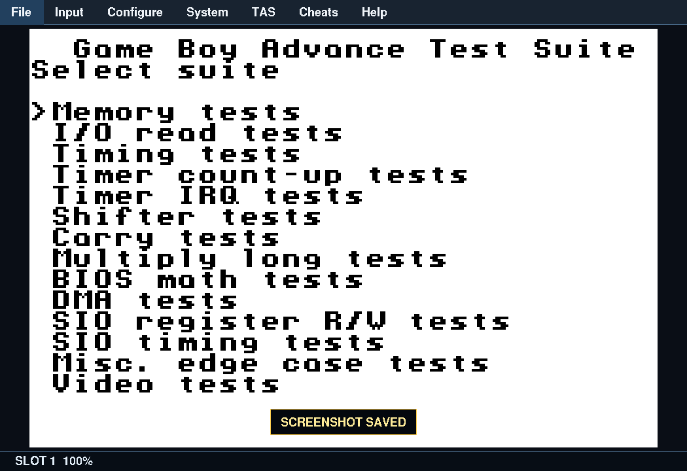

  

<h1 align="center">CipherGBA</h1>

<strong>A cross-platform Game Boy Advance emulator written in C++17</strong>

Developed by <strong>HodgkinsStudios</strong>

  <a href="https://github.com/HodgkinsStudios/CipherGBA/releases/latest"><strong>Download</strong></a> ·
  <a href="#build-from-source">Build from source</a> ·
  <a href="#documentation">Documentation</a> ·
  <a href="CHANGELOG.md">Changelog</a>

CipherGBA emulates the Nintendo **Game Boy Advance** with a separately buildable C++17 core, integrated high-level emulation (HLE) BIOS, and support for an optional user-supplied original GBA BIOS. Native **Linux X11** and portable **SDL2** frontends provide a consistent desktop interface across Linux, Windows, and macOS.

  

Desktop interface with the seven-menu toolbar, game viewport, and compact status bar.

## Features

- **Cartridges:** Load Game Boy Advance games from `.gba` files and supported `.zip` archives.
- **Video:** Aspect-preserving scaling, windowed mode, fullscreen, and optional stretched fullscreen.
- **Audio:** GBA sound emulation, channel controls, and host audio output.
- **Controls:** Keyboard and gamepad support, customizable bindings for all ten standard GBA buttons, and controller detection/reconnection.
- **Persistence:** SRAM, Flash, and EEPROM battery saves; four save-state slots; PNG screenshots.
- **Tools:** TAS input recording/playback, AVI recording, and supported RAW, CodeBreaker, GameShark, and Action Replay cheat codes.
- **BIOS options:** Built-in HLE or an original 16 KiB GBA BIOS supplied by the user.
- **Architecture:** Reusable emulator core separated from its native X11 and cross-platform SDL2 desktop frontends.

The desktop menu bar provides **File · Input · Configure · System · TAS · Cheats · Help**, with controller configuration, cheats, and About available inside the application window. Fast-forward and rewind controls are not included.

See the [frontend guide](docs/FRONTEND.md) and [platform documentation](docs/PLATFORMS.md) for implementation and platform differences.

## Download

**[Download the latest official release](https://github.com/HodgkinsStudios/CipherGBA/releases/latest)** — current release: **v0.3.0**.

| Platform | Package |
| --- | --- |
| Windows (x64) | [Windows ZIP](https://github.com/HodgkinsStudios/CipherGBA/releases/download/v0.3.0/CipherGBA-v0.3-Windows-x64.zip) |
| macOS (Apple Silicon) | [macOS ARM64 ZIP](https://github.com/HodgkinsStudios/CipherGBA/releases/download/v0.3.0/CipherGBA-v0.3-macOS-arm64.zip) |
| macOS (Intel) | [macOS x86_64 ZIP](https://github.com/HodgkinsStudios/CipherGBA/releases/download/v0.3.0/CipherGBA-v0.3-macOS-x86_64.zip) |
| Linux X11 / XWayland (x86_64) | [Native Linux ZIP](https://github.com/HodgkinsStudios/CipherGBA/releases/download/v0.3.0/CipherGBA-v0.3-Linux-X11-x86_64.zip) |
| Linux (x86_64) | [AppImage](https://github.com/HodgkinsStudios/CipherGBA/releases/download/v0.3.0/CipherGBA-v0.3-Linux-x86_64.AppImage) |
| Linux (x86_64) | [Flatpak](https://github.com/HodgkinsStudios/CipherGBA/releases/download/v0.3.0/CipherGBA-v0.3-Linux-x86_64.flatpak) |
| All platforms | [Combined distribution](https://github.com/HodgkinsStudios/CipherGBA/releases/download/v0.3.0/CipherGBA-v0.3-ALL-PLATFORMS.zip) |
| Source | [Source archive](https://github.com/HodgkinsStudios/CipherGBA/releases/download/v0.3.0/CipherGBA-v0.3-Source.zip) |

Release downloads include a [SHA-256 checksum manifest](https://github.com/HodgkinsStudios/CipherGBA/releases/download/v0.3.0/SHA256SUMS.txt).

### Running the emulator

1. Download and extract the appropriate package for your operating system.
2. Launch **CipherGBA** (or **CipherGBA.app** on macOS).
3. Select **File → Load ROM** and choose your legally obtained `.gba` game or supported ZIP archive.
4. Optionally choose **File → Load BIOS** to use your own original GBA BIOS; otherwise, the integrated HLE BIOS is available.

On Linux, make the AppImage executable before launching it:

`chmod +x CipherGBA-v0.3-Linux-x86_64.AppImage`

The Flatpak package requires the freedesktop 25.08 runtime. Install it with:

`flatpak install --user ./CipherGBA-v0.3-Linux-x86_64.flatpak`

Then launch with:

`flatpak run io.github.hodgkinsstudios.CipherGBA`

**Platform notes:** The native Linux build needs its bundled core shared library alongside the executable. Windows users should keep the packaged DLLs beside `CipherGBA.exe`. macOS applications are ad-hoc signed, not notarized; macOS security prompts may apply. See [platform details](docs/PLATFORMS.md).

## Build from source

### Ubuntu / Linux X11

Requirements: C++17 toolchain, CMake, X11 development headers, zlib, and Python 3.

~~~bash
sudo apt update
sudo apt install -y build-essential cmake libx11-dev zlib1g-dev python3
./build.sh
./run.sh
~~~

The native Linux build produces an executable and separate `libCipherGBA_Core.so.1` library.

### Linux SDL2 frontend

~~~bash
sudo apt install -y build-essential cmake libsdl2-dev libdbus-1-dev zlib1g-dev python3
cmake -S . -B build-sdl -DCMAKE_BUILD_TYPE=Release \
  -DCIPHERGBA_FRONTEND=SDL2 -DPIXELGBA_ENABLE_LTO=OFF
cmake --build build-sdl --target CipherGBA -j 2
./bin/CipherGBA
~~~

Use `-DPIXELGBA_BUILD_GUI=OFF` to build the emulator core without a desktop frontend. The [cross-platform workflow](.github/workflows/portability.yml) contains packaging and build configurations for Windows, macOS, and Linux.

## Controls

Default keyboard bindings:

| GBA input | Keyboard |
| --- | --- |
| A / B | Z / X |
| Start / Select | Enter / Backspace |
| D-pad | Arrow keys |
| L / R | A / S |

Bindings can be changed under **Configure → Controller Input**.

Common **SDL2 frontend** shortcuts:

| Action | Shortcut |
| --- | --- |
| Open ROM / Load BIOS | Ctrl+O / Ctrl+B |
| Configure controller | Ctrl+I |
| Menu / TAS menu | F1 / F3 |
| Reset / Mute / Pause | F2 / F4 / F7 |
| Save / Load state | F5 / F8 |
| Cycle save-state slot | F6 |
| Screenshot | F9 |
| Stretch scaling | F10 |
| Fullscreen | F11 or Esc |
| Toggle AVI recording | F12 |

Keyboard shortcuts and native file dialogs can differ between frontend implementations. Save files and input settings are stored under host-specific user-data directories; see [platform details](docs/PLATFORMS.md).

## Accuracy and testing

The documented test-suite baseline is **6,994 of 6,998 scored checks (99.9428%)**, both with the integrated HLE BIOS and with an original BIOS. **Four HBlank-related checks remain unresolved.** This is a previously recorded result, not a fresh test run or a claim of perfect hardware accuracy.

Automated builds and smoke tests cover important regressions, but successful CI does **not** establish full game compatibility, real-device GUI correctness, or sustained full speed on every computer.

Read the [accuracy report](docs/ACCURACY.md), [compatibility guidance](docs/COMPATIBILITY.md), and [platform acceptance checklist](docs/PLATFORM_ACCEPTANCE.md) for the evidence and limitations.

## Documentation

| Guide | Contents |
| --- | --- |
| [Frontend](docs/FRONTEND.md) | Desktop layout, menus, input configuration, display behavior |
| [Platform support](docs/PLATFORMS.md) | Supported systems, packaging, and host-specific behavior |
| [Cheat codes](docs/CHEATS.md) | Supported formats, syntax, and code editing |
| [Accuracy](docs/ACCURACY.md) | Test methodology, numerical results, unresolved checks |
| [Performance](docs/PERFORMANCE.md) | Build optimization and performance diagnostics |
| [Development](docs/DEVELOPMENT.md) | Architecture and remaining validation priorities |
| [Changelog](CHANGELOG.md) | Release history and documentation updates |

## Legal and licensing

CipherGBA is an independent emulator and is **not affiliated with or endorsed by Nintendo**. No copyrighted Nintendo game ROMs or BIOS images are distributed with the project. Use software and firmware you are legally entitled to use.

A project-wide public license has **not** been selected. Certain attributed cheat-table data is covered by file-specific **MPL-2.0** terms; see [Third-party notices](THIRD_PARTY_NOTICES.md).
